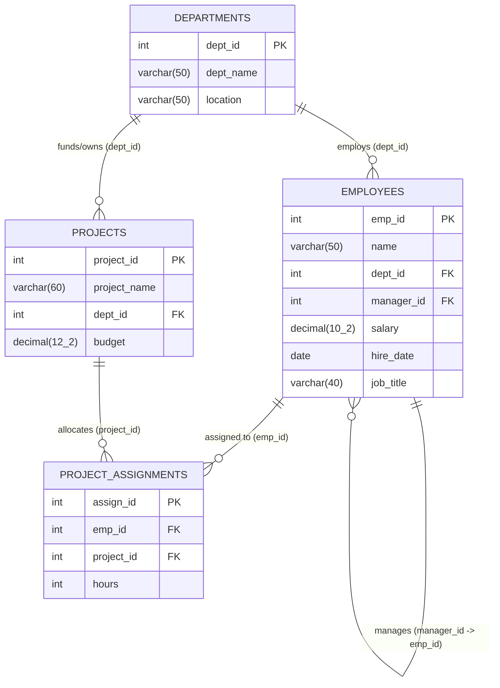

# DATAFORGE - HR and Project Management System

**Technology Stack:** Java JDK 26, MySQL Server 8.0, MySQL Connector/J (JDBC), Object-Oriented Programming (OOP)  
**Target Database:** `dataforge`  
**Team:** DATAFORGE  

---

## 1. Project Overview

The **HR and Project Management System** is a robust, menu-driven console application built to manage human resources and project allocations across departments. The system incorporates Object-Oriented Programming (OOP) principles, JDBC connection management, safe resource handling (`try-with-resources`), dynamic ASCII table rendering, and 15 analytical SQL queries matching Scenario 2 specifications.

---

## 2. Database Architecture & Schema Design

The database named `dataforge` consists of four relational tables:



### Foreign Key Insertion Order

Foreign key constraints require inserting data in a strictly controlled sequence:
1. `departments` (primary independent entity)
2. `employees` (references `departments`, and references `employees` for `manager_id`; top managers with `manager_id = NULL` are placed first)
3. `projects` (references `departments`)
4. `project_assignments` (references both `employees` and `projects`)

### Idempotency and Database Safety
The database setup script (`sql/setup_database.sql`) uses `CREATE DATABASE IF NOT EXISTS`, `CREATE TABLE IF NOT EXISTS`, and `INSERT IGNORE INTO` syntax. Executing the setup script multiple times will **not** create duplicate records or violate primary/foreign keys.

---

## 3. Project Directory Structure

```
POAI-main/
│
├── sql/
│   ├── setup_database.sql       # Safe, idempotent schema and sample data setup
│   └── reset_database.sql       # Clean teardown script for database reset
│
├── lib/
│   └── mysql-connector-j-8.3.0.jar  # Official MySQL JDBC Driver
│
├── src/main/java/com/dataforge/
│   ├── Main.java                # Application entry point & interactive menu
│   ├── config/
│   │   └── DatabaseConnection.java # Environment-aware JDBC connection manager
│   ├── model/
│   │   └── Report.java          # Encapsulates report metadata & SQL query
│   ├── service/
│   │   └── ReportService.java   # Catalogs and executes all 15 report queries
│   └── util/
│       └── TablePrinter.java    # Auto-sizing ASCII console table renderer
│
├── pom.xml                      # Standard Maven build configuration
├── run.bat                      # Windows CMD one-click launcher
├── run.ps1                      # PowerShell one-click launcher
└── README.md                    # Project documentation
```

---

## 4. Database Setup & Configuration

### Step 1: Run the Database Setup Script
From PowerShell:
```powershell
Get-Content sql/setup_database.sql | mysql -u root -p
```
Or from Command Prompt:
```cmd
mysql -u root -p < sql/setup_database.sql
```
*(Enter your MySQL root password when prompted)*

### Step 2: Database Credentials & Environment Variables
The application reads connection settings from environment variables if set:
- `DB_URL` (Default: `jdbc:mysql://localhost:3306/dataforge?useSSL=false&allowPublicKeyRetrieval=true&serverTimezone=UTC`)
- `DB_USER` (Default: `root`)
- `DB_PASSWORD` (Default: `root`)

To customize credentials in PowerShell:
```powershell
$env:DB_USER = "your_mysql_user"
$env:DB_PASSWORD = "your_mysql_password"
```

In Command Prompt:
```cmd
set DB_USER=your_mysql_user
set DB_PASSWORD=your_mysql_password
```

---

## 5. How to Compile & Run

### Method A: Using PowerShell Launcher (Recommended)
```powershell
.\run.ps1
```

### Method B: Using Windows Batch File
```cmd
run.bat
```

### Method C: Using Maven (if Maven is installed)
```bash
mvn clean compile exec:java
```

### Method D: Manual Compilation & Execution
```cmd
javac -cp "lib/mysql-connector-j-8.3.0.jar" -d bin src/main/java/com/dataforge/config/*.java src/main/java/com/dataforge/model/*.java src/main/java/com/dataforge/service/*.java src/main/java/com/dataforge/util/*.java src/main/java/com/dataforge/Main.java

java -cp "bin;lib/mysql-connector-j-8.3.0.jar" com.dataforge.Main
```

---

## 6. Implemented Reports (All 15 Questions)

| # | Difficulty | Report Title | Expected Output Summary |
|---|---|---|---|
| **Q1** | Easy | IT Department Employees | Ramesh, Sunita, Vikram, Sneha |
| **Q2** | Easy | High Earners (> 60,000) | Ramesh (95,000), Nisha (85,000), Lata (70,000), Pooja (65,000) |
| **Q3** | Easy | Employees Hired After 2021-01-01 | Vikram, Manoj, Omkar, Rohit, Sneha |
| **Q4** | Easy | Employee Salary Statistics | Total: 10, Max: 95,000, Min: 40,000, Avg: 61,300.00 |
| **Q5** | Easy | Departments in Chennai | IT, Marketing |
| **Q6** | Easy | Names Starting with 'S' | Sunita, Sneha |
| **Q7** | Easy | Employees Without Manager | Ramesh, Lata, Nisha, Pooja |
| **Q8** | Easy | High Budget Projects (> 700,000) | Data Warehouse (1.5M), Mobile App (1.2M), Payroll System (800K) |
| **Q9** | Medium | Department Headcount & Avg Salary | IT (4), HR (2), Finance (2), Marketing (2), Legal (0, NULL) |
| **Q10** | Medium | Employee & Manager Directory | Shows managers; displays `NULL` for top leadership |
| **Q11** | Medium | Total Hours Logged Per Project | Mobile App (280), Payroll System (190), Data Warehouse (170), Hiring Portal (165), Website Revamp (155) |
| **Q12** | Medium | Unassigned Employees | Ramesh |
| **Q13** | Medium | Departments with Avg Salary > 60k | Finance (67,500), IT (64,500) |
| **Q14** | Medium | Highest Paid Employee Per Dept | Finance: Nisha, HR: Lata, IT: Ramesh, Marketing: Pooja |
| **Q15** | Medium | Cross-Department Project Assignments | Sneha (IT -> Website Revamp / Marketing), Vikram (IT -> Hiring Portal / HR) |

---

## 7. How to Reset the Database

If you wish to cleanly tear down and recreate all tables and seed data:
```powershell
Get-Content sql/reset_database.sql | mysql -u root -p
Get-Content sql/setup_database.sql | mysql -u root -p
```
The reset script drops child tables first (`project_assignments`, `projects`, `employees`, `departments`) in compliance with foreign key constraints.
